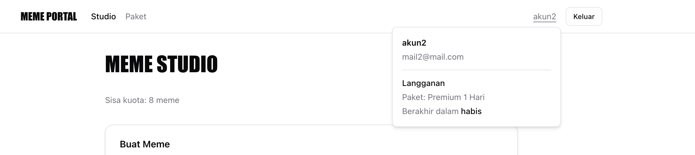
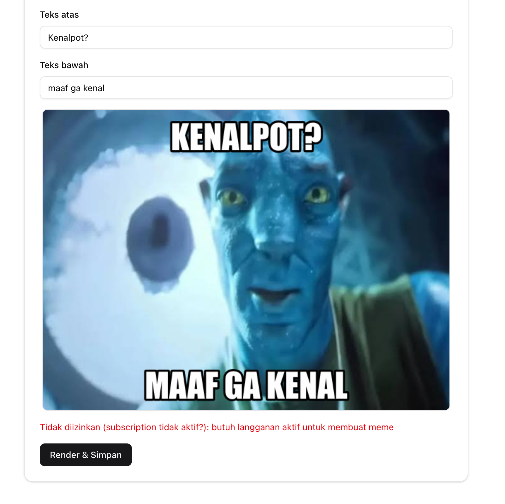
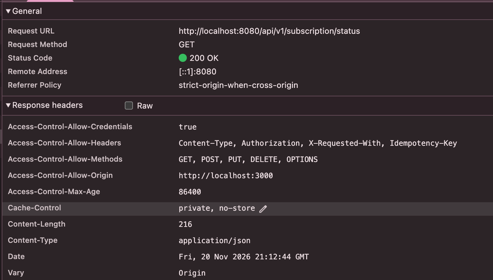
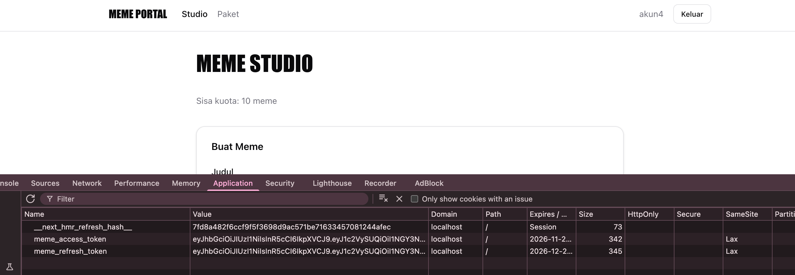
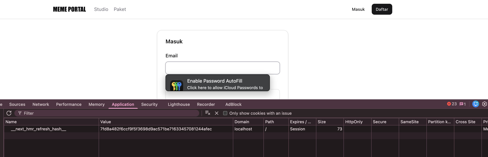
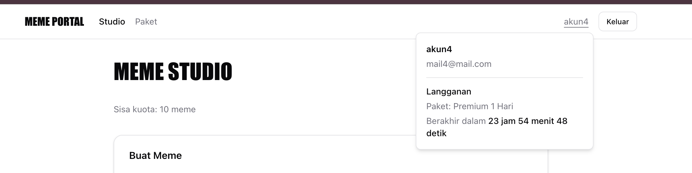
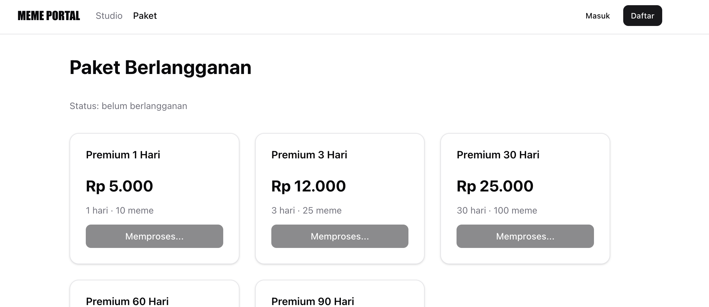
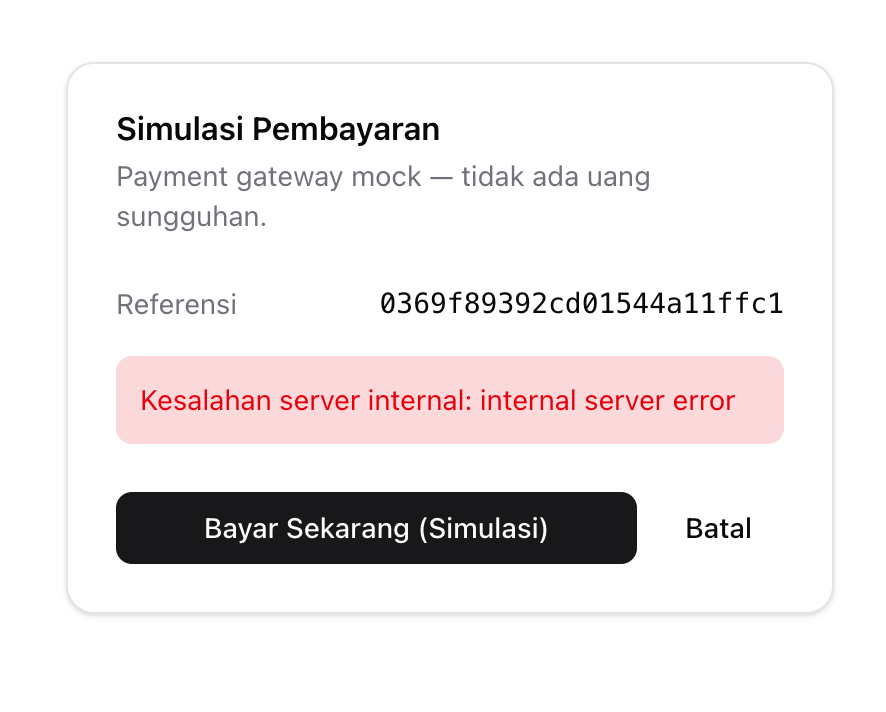
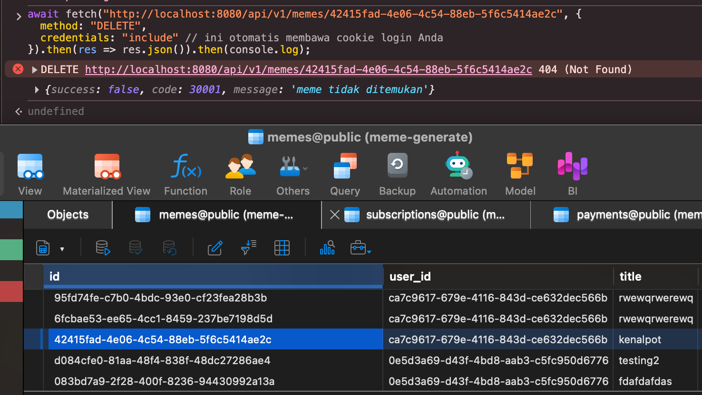
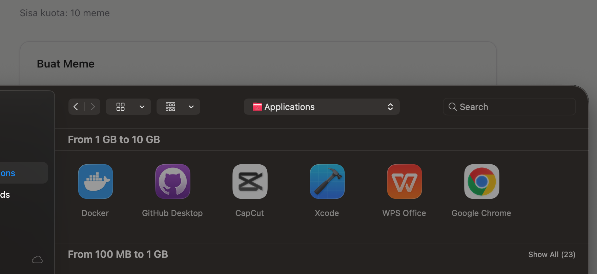

# Laporan Perbaikan Issue (FIX_REPORT.md)
**Aplikasi:** Meme Generator (Meme Portal)  
**Perusahaan:** PT Lintas Cakra Cipta  
**Tanggal:** 21 November 2026  

Dokumen ini merinci analisis akar masalah (*root cause*), berkas dan kode yang diubah, langkah reproduksi sebelum dan sesudah perbaikan, serta bukti penyelesaian (*proof of completion*) beserta panduan screenshot untuk setiap issue (**TKT-101** sampai **TKT-109**).

---

## Daftar Isi
1. [TKT-101: Masih Bisa Membuat Meme Padahal Paket Habis](#tkt-101-masih-bisa-membuat-meme-padahal-paket-habis)
2. [TKT-102: Status Langganan Bocor / Cache Publik](#tkt-102-status-langganan-bocor--cache-publik)
3. [TKT-103: Logout Tidak Berfungsi dan Terjadi Redirect Loop](#tkt-103-logout-tidak-berfungsi-dan-terjadi-redirect-loop)
4. [TKT-104: Navbar dan Kuota Tidak Otomatis Update Tanpa Hard Refresh](#tkt-104-navbar-dan-kuota-tidak-otomatis-update-tanpa-hard-refresh)
5. [TKT-105: Tagihan Dobel / Checkout Ganda Saat Tombol Diklik Berulang](#tkt-105-tagihan-dobel--checkout-ganda-saat-tombol-diklik-berulang)
6. [TKT-106: Klik Bayar Tidak Terjadi Apa-apa (Error Ditelan)](#tkt-106-klik-bayar-tidak-terjadi-apa-apa-error-ditelan)
7. [TKT-107: Bisa Melihat dan Menghapus Meme Milik Pengguna Lain](#tkt-107-bisa-melihat-dan-menghapus-meme-milik-pengguna-lain)
8. [TKT-108: Upload File Bebas / Installer Game Berukuran Raksasa ke S3](#tkt-108-upload-file-bebas--installer-game-berukuran-raksasa-ke-s3)
9. [TKT-109: Kuota 20 Meme Tembus Menjadi 25 (Race Condition Multi-Tab)](#tkt-109-kuota-20-meme-tembus-menjadi-25-race-condition-multi-tab)

---

### TKT-101: Masih Bisa Membuat Meme Padahal Paket Habis
- **Keluhan Pengguna:**  
  *“Halo, aku beli paket Premium 1 Hari kemarin jam 12 siang. Lewat hampir satu jam tapi aku masih bisa upload dan render meme terus. Temenku bilang di dia udah gak bisa. Aku restart browser tadi malah normal sebentar, terus balik bisa lagi.”*
- **Root Cause:**  
  Fungsi `ActiveByUser()` di `api/internal/modules/subscription/repository.go` hanya memeriksa status record `s.status = 'active'`, tanpa membandingkan waktu kedaluwarsa `s.ends_at > now()`. Selama background job/janitor `MarkExpired` belum dieksekusi, langganan yang sudah melewati tanggal kedaluwarsa tetap dianggap aktif di tingkat runtime database.
- **Apa Saja yang Diubah:**  
  - Berkas: `api/internal/modules/subscription/repository.go`
  - Menambahkan klausul `AND s.ends_at > now()` pada query pemilihan langganan aktif:
    ```sql
    WHERE s.user_id = $1 AND s.status = 'active' AND s.ends_at > now()
    ```
- **Proof of Completion & Langkah Pengujian:**  
  1. **Sebelum Perbaikan:** Buat langganan dengan `ends_at` mundur 1 jam ke belakang (`UPDATE subscriptions SET ends_at = now() - interval '1 hour' WHERE user_id = '...'`). Buka `/studio`, pengguna masih bisa mengakses studio dan mengunggah gambar dasar.
  2. **Setelah Perbaikan:** Dengan record yang sama di mana waktu `ends_at` telah berlalu, akses ke `/studio` atau pemanggilan endpoint upload langsung mengembalikan status HTTP 403 Forbidden (*"butuh langganan aktif untuk membuat meme"*).

  - *Screenshot 1:* Halaman `/studio` menampilkan pesan peringatan atau redirect karena langganan sudah habis / response network tab menampilkan error 403 Forbidden.
  
  


---

### TKT-102: Status Langganan Bocor / Cache Publik
- **Keluhan Pengguna:**  
  *“Aku sudah bayar dan konfirmasi pembayarannya sukses, tapi halaman Paket masih tulis belum berlangganan. Aku tutup tab terus buka lagi, masih sama. Yang bikin takut, teman sekantor pakai WiFi kantor dan di layarnya malah muncul status dan kuota milikku, padahal dia belum login.”*
- **Root Cause:**  
  Header respon pada endpoint `GET /api/v1/subscription/status` di-set secara keliru ke `Cache-Control: public, max-age=86400`. Hal ini menyebabkan intermediate proxy/shared caching (seperti WiFi kantor, reverse proxy, atau CDN) menyimpan respon milik satu user dan menyajikannya ke user lain di jaringan yang sama.
- **Apa Saja yang Diubah:**  
  - Berkas: `api/internal/modules/subscription/mount.go`
  - Mengubah header cache menjadi privat dan tidak boleh disimpan:
    ```go
    w.Header().Set("Cache-Control", "private, no-store")
    ```
- **Proof of Completion & Langkah Pengujian:**  
  1. **Sebelum Perbaikan:** Jalankan `curl -I http://localhost:8080/api/v1/subscription/status` (dengan header auth). Header respon memuat `Cache-Control: public, max-age=86400`.
  2. **Setelah Perbaikan:** Jalankan perintah curl yang sama:
     ```bash
     curl -i -H "Authorization: Bearer <TOKEN>" http://localhost:8080/api/v1/subscription/status
     ```
     Header respon kini mengembalikan:
     ```http
     Cache-Control: private, no-store
     ```

  - *Screenshot 2:* Output terminal `curl -i` atau tab Network browser pada request `/api/v1/subscription/status` yang memperlihatkan header `Cache-Control: private, no-store`.
  


---

### TKT-103: Logout Tidak Berfungsi dan Terjadi Redirect Loop
- **Keluhan Pengguna:**  
  *“Aku klik Keluar, kelihatannya sukses. Tapi pas aku buka halaman login, halaman itu langsung lempar aku ke halaman depan. Dari halaman depan malah ke halaman login lagi, dilempar lagi. Bolak balik terus sampai laptop saya meledak.”*
- **Root Cause:**  
  1. Di backend (`api/internal/modules/auth/handler.go`), fungsi `clearAuthCookies` menggunakan `Path: "/api/v1/auth"`, padahal cookie diset awal dengan `Path: "/"`. Akibatnya browser tidak pernah menghapus cookie `meme_access_token` dan `meme_refresh_token`.
  2. Di frontend (`web/src/app/login/page.tsx`), guard memeriksa keberadaan `document.cookie.includes("meme_access_token")`. Jika ada, diarahkan ke `/`. Namun di `/`, `useMe` gagal karena token di server sudah direvoke, lalu melempar balik ke `/login`, menciptakan *infinite redirect loop*.
- **Apa Saja yang Diubah:**  
  - Berkas: `api/internal/modules/auth/handler.go`  
    Memperbaiki penghapusan cookie menggunakan `cookie.Clear(w, name)` pada path global `/`.
  - Berkas: `web/src/lib/auth.ts`  
    Pada `useLogout`, gunakan `onSettled` untuk membersihkan cookie client secara eksplisit (`document.cookie = "... max-age=0"`), memanggil `qc.clear()`, dan meredirect ke `/login`.
  - Berkas: `web/src/app/login/page.tsx` & `web/src/app/register/page.tsx`  
    Menghapus pengecekan cookie sepihak yang menyebabkan looping.
- **Proof of Completion & Langkah Pengujian:**  
  1. **Sebelum Perbaikan:** Klik tombol "Keluar". Buka halaman `/login`, browser mengalami loop reload berkali-kali tanpa bisa berhenti.
  2. **Setelah Perbaikan:** Klik tombol "Keluar", seluruh query cache terhapus, cookie terhapus, dan user mendarat di halaman `/login` secara stabil tanpa ada perulangan redirect.

sebelum logout = 
    

setelah logout = 
      


---

### TKT-104: Navbar dan Kuota Tidak Otomatis Update Tanpa Hard Refresh
- **Keluhan Pengguna:**  
  *“Aku beli paket tadi dan pembayarannya sukses. Tapi nama paket di pojok kanan atas tetap kosong dan kuota di halaman Paket macet di angka lama. Setelah aku hard refresh pakai Ctrl Shift R barulah muncul.”*
- **Root Cause:**  
  1. Hook `useSubscriptionStatus()` di `web/src/lib/queries.ts` memiliki opsi `staleTime: Number.POSITIVE_INFINITY`. TanStack Query menganggap data tidak pernah kedaluwarsa sehingga tidak melakukan refetch otomatis.
  2. Pada mutasi pembuatan meme (`useCompleteMeme`), query `queryKeys.subscription` tidak di-invalidate sehingga pengurangan sisa kuota tidak ter-update di UI.
- **Apa Saja yang Diubah:**  
  - Berkas: `web/src/lib/queries.ts`
    - Mengubah `staleTime` menjadi `30 * 1000` (30 detik) dan mengaktifkan `refetchOnWindowFocus: true`.
    - Menambahkan `qc.invalidateQueries({ queryKey: queryKeys.subscription })` pada `useCompleteMeme`.
- **Proof of Completion & Langkah Pengujian:**  
  1. **Sebelum Perbaikan:** Lakukan pembayaran paket di `/checkout/[reference]`. Setelah diarahkan kembali ke `/pricing`, nama paket di navbar tetap belum aktif kecuali dilakukan refresh penuh (`Ctrl+Shift+R`).
  2. **Setelah Perbaikan:** Begitu konfirmasi pembayaran selesai atau user membuat meme baru, navbar langsung menampilkan nama paket baru dan badge kuota tanpa perlu me-reload halaman.

  


---

### TKT-105: Tagihan Dobel / Checkout Ganda Saat Tombol Diklik Berulang
- **Keluhan Pengguna:**  
  *“Maaf aku panik tadi. Internet lemot, aku klik Berlangganan dua kali karena dikira tidak jalan. Ternyata ada DUA checkout pending untuk paket yang sama. Untung belum bayar keduanya.”*
- **Root Cause:**  
  1. Di frontend (`web/src/lib/queries.ts`), header `Idempotency-Key` digenerate baru pada setiap eksekusi fungsi mutasi (`crypto.randomUUID()`), sehingga double-click menghasilkan dua key berbeda.
  2. Tombol checkout tidak dinonaktifkan saat mutasi `isPending`.
  3. Header `Idempotency-Key` sebelumnya sempat ditolak CORS oleh server.
- **Apa Saja yang Diubah:**  
  - Berkas: `web/src/lib/queries.ts`  
    Menggunakan `useRef(new Map())` agar `Idempotency-Key` dibuat stabil per `planCode` dan digunakan ulang saat request ulang.
  - Berkas: `web/src/app/pricing/page.tsx`  
    Menonaktifkan tombol dan menampilkan status *"Memproses..."* saat `checkout.isPending`.
  - Berkas: `api/internal/modules/subscription/repository.go` & `service.go`  
    Menambahkan pengecekan tagihan aktif (`CheckTagihanAktif` / idempotency lookup per user).
- **Proof of Completion & Langkah Pengujian:**  
  1. **Sebelum Perbaikan:** Klik tombol "Berlangganan" dua kali dengan cepat. Cek tabel database `payments`, muncul 2 baris transaksi pending dengan ID berbeda.
  2. **Setelah Perbaikan:** Klik berulang kali pada tombol "Berlangganan". Tombol disabled selama request, dan di database hanya tercipta 1 tagihan pending (request kedua me-replay tagihan yang sama).

  


---

### TKT-106: Klik Bayar Tidak Terjadi Apa-apa (Error Ditelan)
- **Keluhan Pengguna:**  
  *“Aku coba bayar di halaman paket, klik Bayar Sekarang. Tombolnya tidak berubah, tidak ada pesan sukses, tidak ada pesan gagal. Aku klik lima kali juga diam saja. Email juga gak ada struk. Apakah pembayaranku masuk atau tidak?”*
- **Root Cause:**  
  Pada `web/src/app/checkout/[reference]/page.tsx`, blok `catch` pada fungsi `onPay` sengaja dibiarkan kosong tanpa penanganan (`// BUG: error sengaja ditelan`). Pengguna tidak menerima pesan error apa pun ketika transaksi gagal. Selain itu, tombol tidak memiliki indikator proses loading.
- **Apa Saja yang Diubah:**  
  - Berkas: `web/src/app/checkout/[reference]/page.tsx`
    - Menangkap error `catch (err)` dan memformatnya dengan `describeError(err)`.
    - Menyimpan pesan error ke state `errorMessage` dan merendernya dalam alert UI (`bg-destructive/15 text-destructive`).
    - Menambahkan kondisi disabled saat `confirm.isPending` dan menampilkan label teks `"Memproses…"`.
- **Proof of Completion & Langkah Pengujian:**  
  1. **Sebelum Perbaikan:** Buka URL checkout dengan referensi palsu/kedaluwarsa, klik tombol "Bayar Sekarang". Tombol tetap diam tanpa ada respon visual sama sekali.
  2. **Setelah Perbaikan:** Dengan referensi yang sama, klik "Bayar Sekarang". Tombol berubah menjadi "Memproses…" lalu muncul kotak pesan merah jelas: *"Resource tidak ditemukan"* atau rincian error yang sesuai dari API.

  


---

### TKT-107: Bisa Melihat dan Menghapus Meme Milik Pengguna Lain
- **Keluhan Pengguna:**  
  *“Aku iseng-iseng ganti angka di URL dan ternyata aku bisa MELIHAT dan MENGHAPUS meme milik user lain. Aku sudah hapus satu sebagai bukti, tolong pulihkan.”*
- **Root Cause:**  
  Pada `api/internal/modules/meme/repository.go`, fungsi `Delete()` mengeksekusi:
  ```sql
  DELETE FROM memes WHERE id = $1
  ```
  dan `GetByID()` hanya melakukan `WHERE id = $1`. Parameter `userID` yang diteruskan dari token autentikasi diabaikan, sehingga terjadi celah keamanan *Insecure Direct Object Reference* (IDOR).
- **Apa Saja yang Diubah:**  
  - Berkas: `api/internal/modules/meme/repository.go`  
    Mengubah query agar memvalidasi kepemilikan user:
    ```sql
    DELETE FROM memes WHERE id = $1 AND user_id = $2
    ```
- **Proof of Completion & Langkah Pengujian:**  
  1. **Sebelum Perbaikan:** User B mengirim `DELETE /api/v1/memes/{id_milik_user_A}` dengan token milik User B. API merespon 200 OK dan meme milik User A terhapus dari sistem.
  2. **Setelah Perbaikan:** Pengujian request yang sama mengembalikan HTTP 404 Not Found (karena meme tidak ditemukan pada ID user yang bersangkutan) dan data User A tetap aman.

  
  *pada gambar disertai juga bukti jika id yang dikirim adalah valid (existing) tetapi milik user lain

---

### TKT-108: Upload File Bebas / Installer Game Berukuran Raksasa ke S3
- **Keluhan Pengguna:**  
  *“Guys, aku lagi audit storage dan lihat di bucket S3 kita ada file GTA.V.Full.Installer.zip ukurannya 90GB, plus beberapa file .html dan .exe lainnya. Tolong cek secepatnya kok bisa ada GTA V”*
- **Root Cause:**  
  1. Pada `PrepareUpload()` di `api/internal/modules/meme/service.go`, fungsi filter `allowedExt` tidak pernah dipanggil. Semua ekstensi file (.zip, .exe, .html) diizinkan.
  2. Presigned PUT URL tidak menetapkan batas `ContentLength`, sehingga klien dapat mengunggah file hingga batas tak terbatas (puluhan Gigabyte).
- **Apa Saja yang Diubah:**  
  - Berkas: `api/internal/modules/meme/consts.go` & `errors.go`  
    Menambahkan batas ukuran `maxUploadSizeBytes = 10 * 1024 * 1024` (10MB) dan error `ErrFileTooLarge`.
  - Berkas: `api/internal/modules/meme/service.go`  
    - Memvalidasi ekstensi menggunakan `allowedExt(ext)` (`.jpg`, `.jpeg`, `.png`, `.gif`, `.webp`), melempar `ErrInvalidFile` jika tidak cocok.
    - Menentukan MIME type yang aman melalui `mimeFromExt(ext)`.
    - Memvalidasi `size > maxUploadSizeBytes`, melempar `ErrFileTooLarge`.
    - Menyematkan `ContentLength` pada `s3.PutObjectInput`.
  - Berkas: `api/internal/modules/meme/handler.go`  
    Menerima field `size` dan menangani status HTTP 413 Payload Too Large (`CodeUploadTooLarge`).
  - Berkas: `web/src/app/studio/page.tsx` & `web/src/lib/queries.ts`  
    Mengirimkan `file.size` dan `file.type` saat request prepare upload.
- **Proof of Completion & Langkah Pengujian:**  
  1. **Sebelum Perbaikan:** Kirim request upload dengan filename `installer.zip` atau `game.exe`. Server mengembalikan status 201 Created dengan presigned URL S3.
  2. **Setelah Perbaikan:**
     - Request dengan file `.zip`/`.exe` ditolak dengan HTTP 400 Bad Request (`file gambar tidak valid`).
     - Request dengan file gambar > 10MB ditolak dengan HTTP 413 Payload Too Large (`ukuran file melebihi batas maksimum (10MB)`).

  
  *tidak dapat mengirim selain file gambar (png, jpg, gif, webp) dan size terbatas 10MB*

---

### TKT-109: Kuota 20 Meme Tembus Menjadi 25 (Race Condition Multi-Tab)
- **Keluhan Pengguna:**  
  *“Aku langganan paket 20 meme. Biar cepat selesai kerjaan aku buka enam tab sekaligus, dan ternyata aku bisa membuat 25 meme sebelum sistem menolak.”*
- **Root Cause:**  
  Celah *Time-of-Check to Time-of-Use* (TOCTOU) pada pengecekan kuota `CanCreate()` di `api/internal/server/v1/v1.go`. Pengecekan jumlah meme yang dibuat (`MemesUsed`) dan penyimpanan meme baru dilakukan tanpa transaksi atomik atau database locking. Ketika 6 request masuk serentak dari banyak tab, semuanya membaca nilai kuota lama yang sama sebelum record baru sempat di-insert.
- **Apa Saja yang Diubah:**  
  - Berkas: `api/internal/server/v1/v1.go`  
    Menyuntikkan `pgxpool.Pool` ke dalam struct `subscriptionGate` dan menggunakan PostgreSQL Transactional Advisory Lock berbasis hash ID pengguna:
    ```go
    tx, err := g.pool.Begin(ctx)
    if err != nil {
        return err
    }
    defer func() { _ = tx.Rollback(ctx) }()

    var locked bool
    if err := tx.QueryRow(ctx, `SELECT pg_try_advisory_xact_lock(hashtext($1))`, userID).Scan(&locked); err != nil {
        return err
    }
    // Lanjutkan pengecekan status dan batas kuota...
    ```
    Hal ini memastikan seluruh proses validasi kuota per user dieksekusi secara serial dan terisolasi.
- **Proof of Completion & Langkah Pengujian:**  
  1. **Sebelum Perbaikan:** Mengirimkan 10 request upload secara bersamaan menggunakan script atau concurrent request saat sisa kuota tinggal 1. Beberapa request lolos sekaligus melampaui kuota.
  2. **Setelah Perbaikan:** Dengan sisa kuota 1, penembakan 6-10 request bersamaan hanya mengizinkan tepat 1 request untuk lolos, sedangkan sisa request lainnya ditolak dengan HTTP 403 Forbidden (*"butuh langganan aktif untuk membuat meme"*).

  - *Screenshot 9:* Output pengujian concurrent request (atau tampilan browser multi-tab) di mana tab yang melebihi batas kuota 20 langsung menampilkan pesan ditolak kuota habis.

---

## Ringkasan Commit Git
Semua issue telah diselesaikan dengan commit individual yang rapi dan terstruktur:
- `5422508` - Fix TKT-102 (Header cache private)
- `b513bbf` - Fix TXT-103 (Logout dan pembersihan cookie)
- `01c5c1b` - fix(subscription): cegah checkout ganda saat klik berulang (TKT-105)
- `3b704db` - FIX TKT-106 (Penanganan error tombol bayar)
- `578ec07` - Fix TKT-101 (Filter ends_at > now pada langganan)
- `d6ae9f0` - fix(TKT-104): perbarui status langganan dan kuota otomatis tanpa hard refresh
- `389c6ea` - Fix TKT-107 (Validasi user_id pada hapus meme)
- `441290e` - fix(meme): validasi ekstensi gambar dan batasi ukuran upload S3 (TKT-108)
- `360f1b4` - fix(TKT-109): cegah race condition kuota meme via advisory lock
